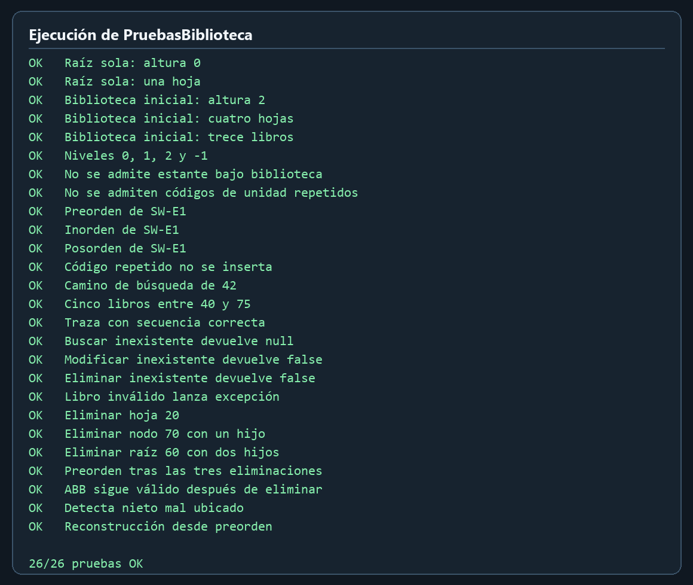

# Catálogo de la Biblioteca FISEI

Este programa representa la biblioteca de dos maneras. La primera es un árbol general: una biblioteca contiene áreas y cada área puede contener varios estantes. La segunda es un árbol binario de búsqueda (ABB) dentro de cada estante, donde los libros se ubican según su código numérico.

El ejemplo inicial incluye las áreas de Software, Tecnologías de la Información y Telecomunicaciones. En total hay siete unidades, cuatro hojas y trece libros. El menú permite consultar la jerarquía, administrar unidades y libros, recorrer los ABB y ejecutar los retos de rango, camino de búsqueda y validación.

## Requisitos

- JDK 17 o posterior.
- Una terminal. No se usan bibliotecas externas.

## Compilar y ejecutar

Desde la carpeta raíz del proyecto, en PowerShell:

```powershell
$archivos = Get-ChildItem src -Recurse -Filter *.java | ForEach-Object FullName
New-Item -ItemType Directory -Force out | Out-Null
javac -encoding UTF-8 -d out $archivos
java -cp out app.Main
```

Para ejecutar las pruebas:

```powershell
java -cp out app.PruebasBiblioteca
```

Para reproducir las trazas personales y las tres eliminaciones:

```powershell
java -cp out app.DemoTrazas
```

En una terminal de Windows que no muestre bien las tildes, ejecuta `chcp 65001` antes del programa.

## Cómo está organizado

| Carpeta | Responsabilidad |
| --- | --- |
| `src/enums` | Tipos de unidad y de recorrido. |
| `src/modelo` | Datos y validaciones de libros y unidades. |
| `src/negocio` | Nodos, árbol general y catálogo ABB. |
| `src/app` | Datos iniciales, menú y pruebas. |

La búsqueda en un ABB compara el código con el nodo actual y continúa solo por el lado que corresponde. Al eliminar un nodo con dos hijos, se toma el menor libro del subárbol derecho: el sucesor inorden. Para contar libros en un rango, se evita recorrer las ramas cuyos códigos ya quedaron fuera de ese intervalo.

## Pruebas

`PruebasBiblioteca` comprueba 26 condiciones, incluidos los tres recorridos pedidos, las tres formas de eliminación, datos inválidos, búsqueda por niveles, la validación de un nieto mal ubicado y la reconstrucción opcional desde preorden. La ejecución local dio **26/26 pruebas OK**.

La siguiente imagen presenta la salida real de `PruebasBiblioteca`, obtenida al ejecutar el programa y representada en un formato legible:



## Trazas personales

`TRAZAS.md` muestra cómo se obtuvieron los códigos 86, 61 y 1, los árboles en Mermaid, los recorridos, la traza de preorden y las tres eliminaciones. `DemoTrazas` permite comparar esa resolución con la salida real del programa.

Antes de la entrega, revisa y explica con tus propias palabras cada caso de prueba y cada decisión del código.
