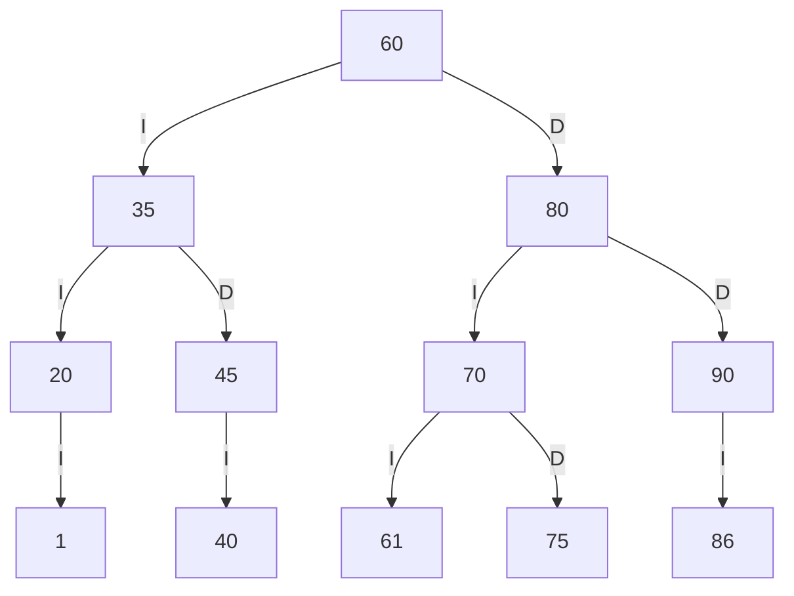
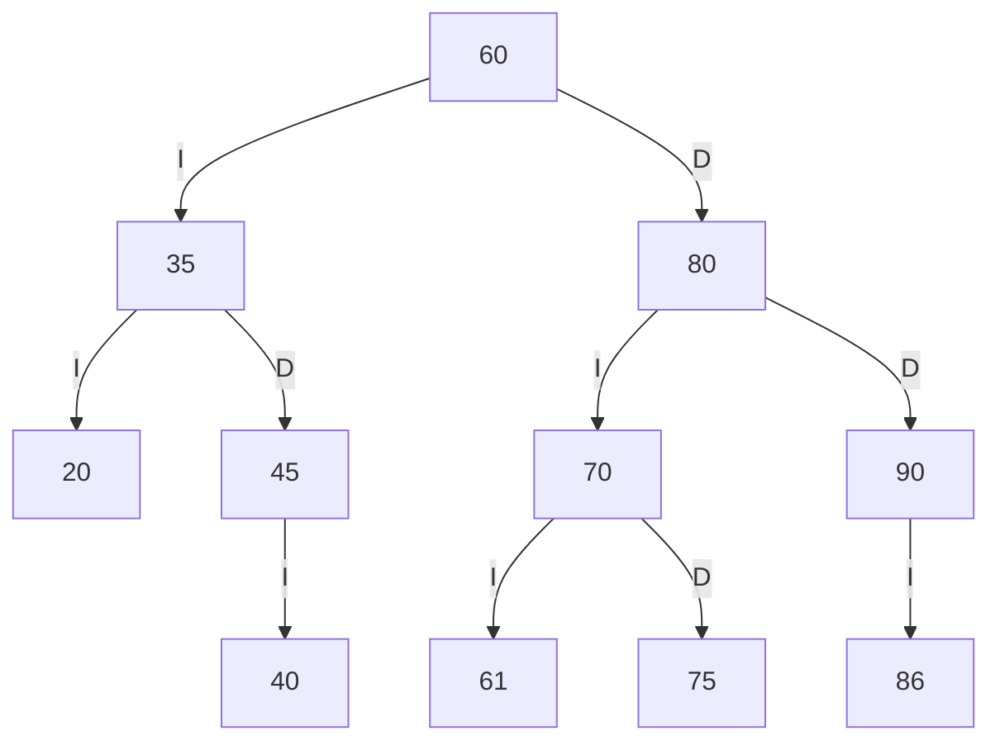
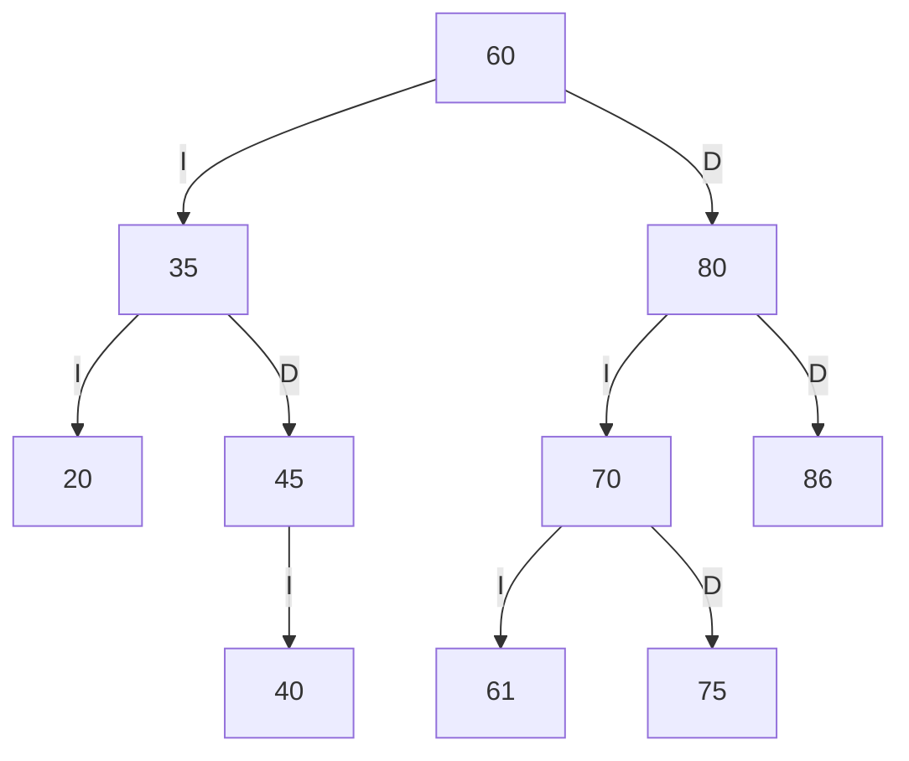
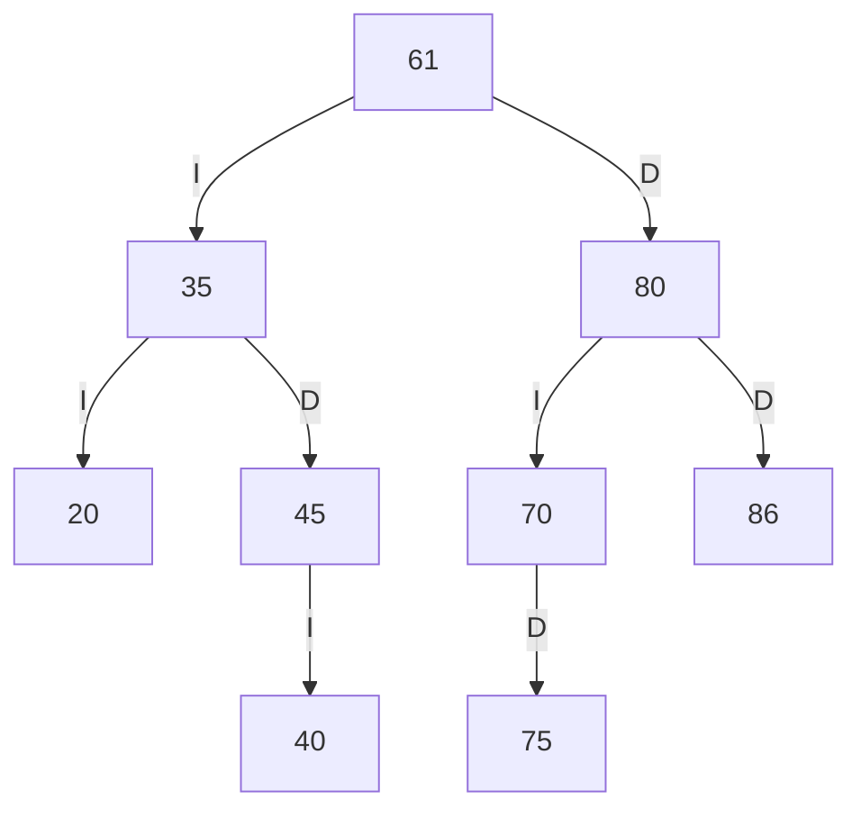

# Trazas personales del ABB de SW-E1

## Códigos personales

Con los últimos cuatro dígitos `8601` formé `86`, `60` y `01`. Como `60` ya estaba en SW-E1, le sumé uno y obtuve `61`. El par `01` se usa como entero `1`: es positivo y no se repite. Así, después de la secuencia inicial `60, 35, 80, 20, 45, 70, 90, 40, 75`, inserté **86, 61 y 1**, en ese orden.

## Árbol tras las inserciones

Comparando desde la raíz, `86` quedó a la izquierda de `90`, `61` a la izquierda de `70` y `1` a la izquierda de `20`.



## Recorridos resueltos a mano

- Preorden (raíz, izquierda, derecha): `60 35 20 1 45 40 80 70 61 75 90 86`
- Inorden (izquierda, raíz, derecha): `1 20 35 40 45 60 61 70 75 80 86 90`
- Posorden (izquierda, derecha, raíz): `1 20 40 45 35 61 75 70 86 90 80 60`

El inorden va de menor a mayor, como debe ocurrir en un ABB válido.

## Traza manual del preorden

Cada nivel tiene dos espacios. `entra` señala la llegada al nodo, `VISITA` su procesamiento y `null -> regresa` un hijo vacío.

```text
entra 60
VISITA 60
  entra 35
  VISITA 35
    entra 20
    VISITA 20
      entra 1
      VISITA 1
        null -> regresa
        null -> regresa
      null -> regresa
    entra 45
    VISITA 45
      entra 40
      VISITA 40
        null -> regresa
        null -> regresa
      null -> regresa
  entra 80
  VISITA 80
    entra 70
    VISITA 70
      entra 61
      VISITA 61
        null -> regresa
        null -> regresa
      entra 75
      VISITA 75
        null -> regresa
        null -> regresa
    entra 90
    VISITA 90
      entra 86
      VISITA 86
        null -> regresa
        null -> regresa
      null -> regresa
Secuencia PREORDEN: 60 35 20 1 45 40 80 70 61 75 90 86
```

## Tres eliminaciones

Las apliqué sobre el árbol personalizado en este orden: `1` (hoja), `90` (un hijo) y `60` (dos hijos).

### 1: hoja

`1` no tiene hijos; simplemente se retira.



Preorden resultante: `60 35 20 45 40 80 70 61 75 90 86`.

### 90: un hijo

`90` solo tiene al hijo izquierdo `86`. Este ocupa su lugar como hijo derecho de `80`.



Preorden resultante: `60 35 20 45 40 80 70 61 75 86`.

### 60: dos hijos

El sucesor inorden de `60` es `61`, el menor código del subárbol derecho. Puse `61` en la raíz y lo retiré de su posición anterior; así se conserva el orden del ABB.



Preorden final: `61 35 20 45 40 80 70 75 86`.

## Comparación con la salida del programa

Compilé el proyecto y ejecuté `java -cp out app.DemoTrazas`. Estas líneas son de la ejecución real:

```text
Códigos personales: 86, 61 (60 ya existía), 1 (de 01)
PREORDEN: 60 35 20 1 45 40 80 70 61 75 90 86
INORDEN: 1 20 35 40 45 60 61 70 75 80 86 90
POSORDEN: 1 20 40 45 35 61 75 70 86 90 80 60
Secuencia PREORDEN: 60 35 20 1 45 40 80 70 61 75 90 86
Eliminar 1 (hoja): true
PREORDEN: 60 35 20 45 40 80 70 61 75 90 86
Eliminar 90 (un hijo): true
PREORDEN: 60 35 20 45 40 80 70 61 75 86
Eliminar 60 (dos hijos): true
PREORDEN: 61 35 20 45 40 80 70 75 86
ABB válido: true
```

| Punto | ¿Coincide? | Comprobación |
| --- | --- | --- |
| Tres inserciones | Sí | Los tres recorridos del programa son iguales a los manuales. |
| Traza de preorden | Sí | La salida completa coincide con la traza de arriba, incluidos los hijos vacíos. |
| Eliminar 1 | Sí | Desaparece la hoja y el resto conserva su posición. |
| Eliminar 90 | Sí | `86` ocupa su lugar. |
| Eliminar 60 | Sí | `61` queda en la raíz como sucesor inorden. |

`DemoTrazas` imprime también los recorridos completos y el resultado de `esABBValido()` después de cada eliminación, por lo que la comparación puede repetirse en cualquier momento.
